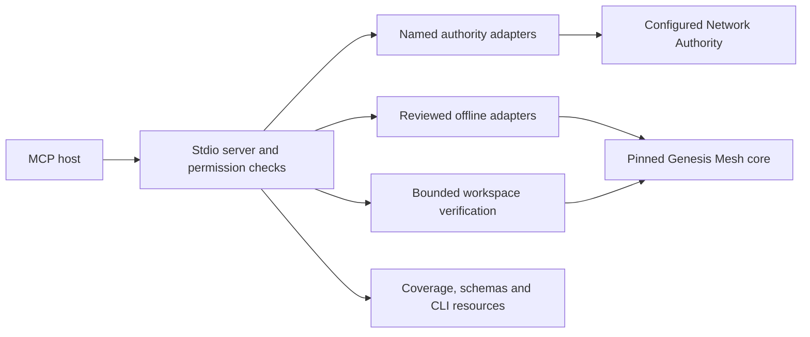

# Architecture and compatibility

The separate repository follows the core's protocol-first boundary. MCP is an application adapter, while Genesis Mesh remains usable without a model provider, agent framework or MCP host.

Tool text content contains the original JSON result. Dictionary results also appear directly in MCP `structuredContent`; lists, scalars and null use `{"result": original_value}` there because MCP requires an object. The contained wire records are preserved unchanged. Clients should unwrap only this documented non-object envelope, not arbitrary dictionaries with a domain field named `result`.

## Modules

| Module | Responsibility |
| --- | --- |
| `server.py` | Protocol lifecycle, paginated discovery, schema validation, profile checks, safe errors and result limits |
| `settings.py` | Immutable configuration, authority origins, file confinement, identity references and per-tool signer permissions |
| `authority.py`, `authority_schemas.py` | Exact method/path binding, reviewed schemas, distinct authentication forms and bounded HTTP transport |
| `offline/registry.py` | Explicit callable allowlist, including CLI-backed capabilities outside the public Python-symbol list |
| `offline/adapter.py` | JSON-to-core type conversion, core wire serialization, signer binding and workload limits |
| `offline/workflows.py` | Typed context, verification and model-construction adapters requiring more than direct function adaptation |
| `local.py` | Read-only trust-bundle, evidence JSONL and audit-pack verification inside the configured workspace |
| `workflows.py` | Core bundle export/review and Atlas rendering through restricted adapters |
| `workflow_config.py`, `runtime_config.py` | Immutable named authorities, fleets, stores, nodes, peers and fixed guard actions |
| `workflow_support.py` | Configured dependencies, private storage, resource locks and durable mutation journals |
| `multi_workflows.py`, `multi_support.py` | Root-pinned federation, fleet aggregation/mesh and recognition/revocation proofs |
| `local_workflows.py` | Audit materialization/archive, held anchors and ordered treaty lifecycle |
| `runtime_workflows.py` | Verified node state, bounded Noise sends and correlated guard requests/receipts |
| `provision_workflows.py`, `proof_workflows.py` | Private fleet scaffolding, canary receipt/audit persistence and disposable proof-store maintenance |
| `catalog.py`, `data/` | Pinned public contract, immutable source provenance, coverage classifications and test evidence |
| `test_evidence.py`, root `conftest.py` | Optional checkout evidence gate and pytest execution receipt; runtime discovery does not require test sources |
| `tool_evidence.py`, `coverage_union.py` | Reviewed per-tool scenario checks and complete supported-platform statement/branch accounting |

## What full reflection means

The core contract currently contains 123 HTTP paths, 137 CLI leaves, 99 public Python symbols, 67 signed artifact types, 334 errors, 11 package declarations and four behavioral rules. Expanding HTTP methods produces 130 operations, of which 14 are internal and 116 public.

Each entry is discoverable and classified. A public Python model is a schema resource, a verifier is a tool, a low-level signer helper is support for a reviewed operation, and a daemon is an operational boundary. CLI value workflows replace command-line file arguments with structured inputs/results where appropriate. This does not imply every CLI flag, local state transition or multi-process workflow has an identical MCP implementation.

The coverage report deliberately distinguishes:

- **implemented**: an actual named adapter is registered, with verification evidence tracked separately;
- **components_available**: relevant operations exist, but the complete multi-step workflow is not implemented;
- **schema/reference/support**: discoverable representations and implementation support, not execution;
- **operational/internal boundary**: a documented hosting, custody or implementation boundary;
- **gap**: an executable capability that remains unimplemented.

Tests do not automatically turn registration counts into behavioral proof. Each recorded test claim names its evidence and scope. The core's classified public contract is the denominator; extra internal helper imports needed for CLI-equivalent adapters remain pinned implementation dependencies rather than new stable API promises.

CI verifies those citations against source-bound pytest receipts and actual registered-handler observations, and requires complete statement/branch coverage across the four supported OS/interpreter combinations. A passing cited test establishes execution; reviewers still assess whether its assertions support the claimed behavior. Schema/reference/custody classifications remain distinct. See [verification evidence](verification.md).

## Authentication and trust outcomes

Operator requests use the core's method/path/query/body/audience signatures. Node requests use dedicated node signing and, for node-scoped routes, purpose and audience binding. Agent descriptor registration and deletion use their distinct core signing formats. Edge enrollment proves executor-key possession before node signing. Public counts and authenticated rosters have separate tools.

Offline signing requires `sign` plus a configured reference explicitly permitted for the named tool. Core cryptography and policy semantics remain unchanged. Signing an oversight artifact is not independent human approval. Root key creation is confined to explicitly enabled private fleet provisioning; keys are never returned. Production root custody and arbitrary raw signing are not exposed.

`authorized: false`, failed verification, revocation and stale-state outcomes stay structured. An HTTP 200 is not permission. A policy decision, execution receipt, successful external action and independently verified audit trail are different claims. The adapter does not execute arbitrary external capabilities or synthesize evidence claiming that it did.

## Compatibility and delivery

Core is pinned to 1.8.1 at `9e4d5c01e6ba7a22e73c17388796ec274f73a2fc`. The normalized public-contract digest is `2c6b23036e5584d0bae53369143be73877d16552f8c43ac32e1a217207f25806`. Runtime checks validate the package version and packaged metadata; source verification also checks the exact commit and tracked cleanliness. CLI parameter references have an independent snapshot check.

The core's proposed contract-bundle release mechanism has not shipped in this baseline. This project therefore uses explicit version/commit/digest pins. It is not enrolled in the core's coordinated release train, and creating this adapter does not change the SDKs' release policies.

Stdio is the delivered transport. Remote HTTP needs a separate authenticated deployment design. Wheel smoke tests run in an isolated interpreter outside the repository; no sibling core checkout, test helpers or development database is required at runtime.
